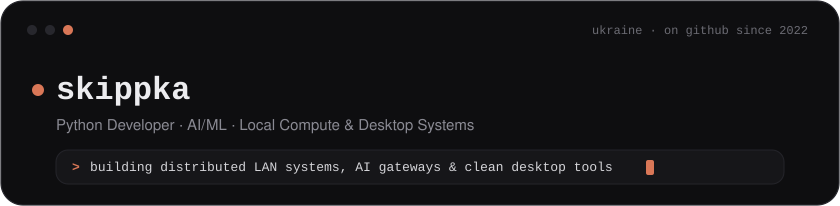
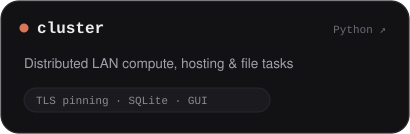
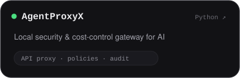
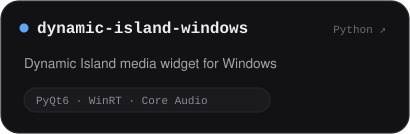
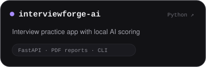

  

  
  
   
  
  

  

  
    also:
    <a href="https://github.com/skippka/MathMatrix_exoplanets">MathMatrix_exoplanets</a> ·
    <a href="https://github.com/skippka/MAH_MNEMOAI">MAH_MNEMOAI</a> ·
    <a href="https://github.com/skippka/volonteer_site_ukraine">volonteer_site_ukraine</a> ·
    <a href="https://discordapp.com/users/628993927164198912">Discord</a>
  

